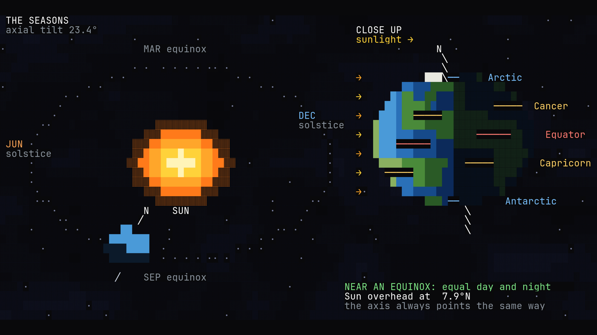

# ascii-magic-screensaver

All 634 animated pieces of [ascii-magic-art](https://github.com/kailashsr38/ascii-magic-art)
([browse them](https://www.ascii-magic.com/ascii)) by ASCII Magic, as an
[Omarchy](https://omarchy.org) screensaver: each piece fills the screen in a
fullscreen WebKit window, played by upstream's own JavaScript, unchanged.

All credit for the pieces, their look and the player goes to ASCII Magic;
go see the original.



## Run

```sh
./install.sh                  # fetch the pieces, install screensaver-session, link the runner
ascii-magic moonlit-sea       # play one piece; a key, click or mouse move stops it
ascii-magic --list            # every piece, as magic:<piece>
```

Needs `gjs`, WebKitGTK 4.1 (`webkit2gtk-4.1`) and `cargo` (to install
[screensaver-session](https://github.com/igouss/screensaver-session)).

It is a [screensaver-rotation](https://github.com/igouss/screensaver-rotation)
runner: `install.sh` links it in as `magic`. Its entries are
`magic:<piece>`, so a piece keeps its own history apart from a shader of the
same name (`plasma`, `metaballs`, `snowfall`, `sierpinski`, `circuit-trace`).
When one comes up the rotation runs

    magic --app-id org.omarchy.screensaver --seed N --log FILE ENTRY...

and the first entry that names a piece plays under `screensaver-session`,
which logs it, hides the pointer, and stops it (and the other monitors') on
a key, click, mouse move, focus loss or session lock. Pieces are
deterministic, so `--seed` is unused and every monitor shows the same frame.

## How it draws

- `vendor/ascii-magic-art` is upstream, a git submodule pinned to a release.
  Nothing is fetched from ascii-magic.com at run time.
- `page/index.html` loads the piece and plays it with upstream's
  `runtime/player.js`, at the font size `page/fit.js` picks to fill the
  window (letterboxed in upstream's export background, `#09090b`).
- `host/host.js` (GJS) is the window: GTK 3 + WebKit2 4.1, app id from the
  program name, and every key, click, scroll and pointer move written to
  stdout for screensaver-session to judge.
- `host/fonts.conf` maps upstream's first font, Menlo, to Hack (Hack Nerd
  Font Mono), for this window only. Hack has Menlo's advance width, 0.602 em,
  which upstream sizes its cells by. Without it fontconfig picks a
  proportional sans, and wide glyphs overflow their cells (an O clipped to
  a C).

## Test

    node --test tests/

checks every piece loads and draws frames of its own size, the fit, the
runner's side of the rotation contract (with screensaver-session and gjs
stubbed), and that Menlo is monospace under `host/fonts.conf`.

## Licence

This repo: MIT. ascii-magic-art: MIT, except `ocean-sunset` and
`starry-ridge`, whose image data is under the Unsplash License; see
upstream's [NOTICE](https://github.com/kailashsr38/ascii-magic-art/blob/main/NOTICE).
